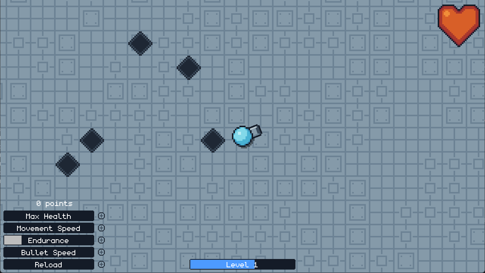
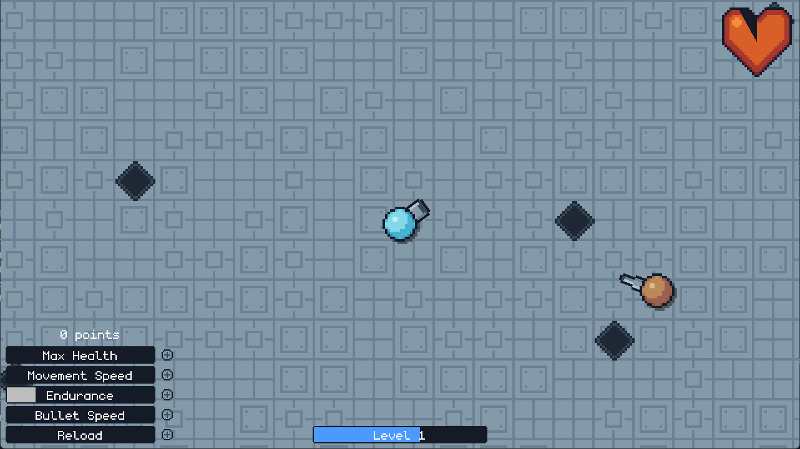
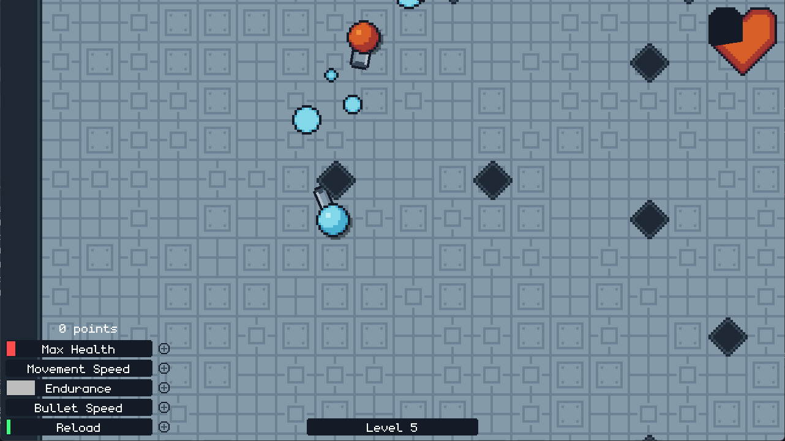
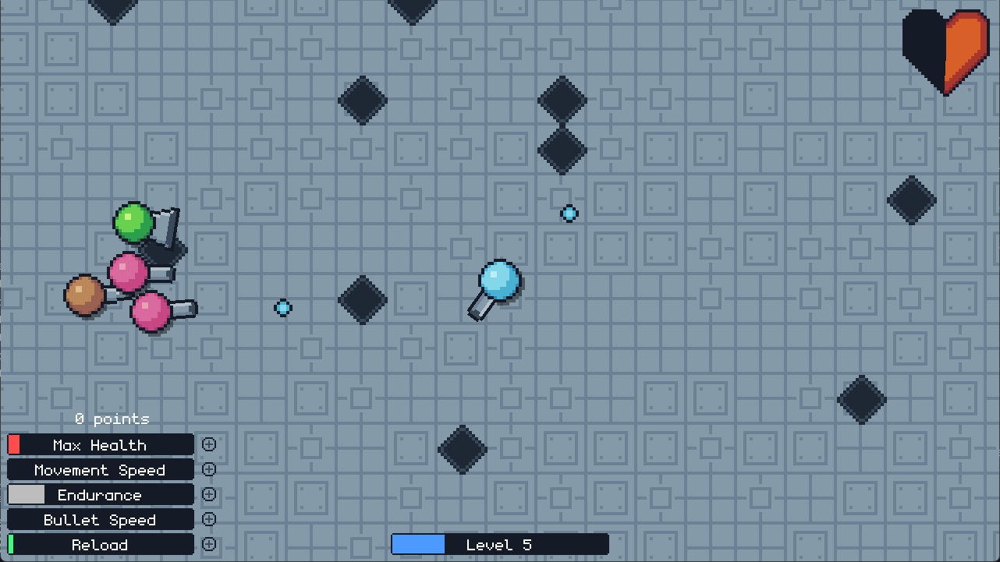

# Geometry Shooter

Geometry Shooter is a bullet hell game where you must dodge and kill enemies and upgrade your stats, with each wave getting harder.

  

  

I never made a bullet hell before so I decided to try making one, it would also show if my ScenePool plugin is powerful and efficient, and it is! This game is inspired a lot by diep.io.

# How to play

The game runs directly in your browser and can be played on itch: [https://wirelessnine.itch.io/lone-island](https://wirelessnine.itch.io/geometry-shooter).

You use WASD to move and left click to shoot. Every wave more enemies spawn. Every time you level up, you get one point, which is used to upgrade your stats like max health, movement speed, endurance, bullet speed and reload speed. Every 5 levels your weapon/turret changes, each turret has its own bullet, reload speed, bullet speed and some have unique functions.

There is a lot more to come to this game, I was tired of it at the end but now that the game loop is finished, I see the potential in this game, so I'm gonna work on it a little more, add some more stuff!

  

  

